# FinanceFlow

A full-stack personal finance manager. Track income and expenses, set monthly budgets with live alerts, and chat with the support team in real time.

Built with **React, Tailwind CSS, Node.js, Express, MongoDB, Socket.IO and Docker**, with automated testing and deployment through **GitHub Actions**.

| | |
|---|---|
| **Live app** | https://finance-flow-kappa-six.vercel.app |
| **Live API** | https://financeflow-api-6k9c.onrender.com (health check: [`/api/health`](https://financeflow-api-6k9c.onrender.com/api/health)) |
| **Author** | Jaiprakash Talreja · Roll No. 54 · D15A, Batch C |

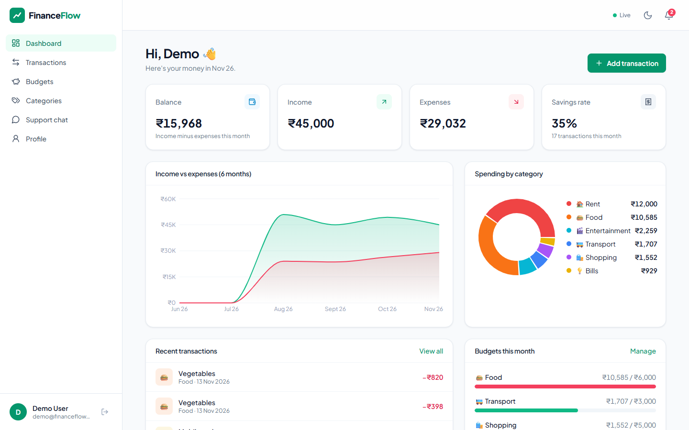

---

## Features

**For users**
- Register / log in with JWT authentication, log out (token revoked on the server)
- Dashboard with balance, savings rate, a 6-month income vs. expense chart and spending by category
- Transactions: add, edit, delete, search by note, filter by type, category and date range, sort, paginate
- Monthly budgets per category with progress bars and **live alerts at 80% and 100%**
- Custom categories with colours and icons
- Real-time **support chat** with typing indicator
- **Live notifications** (budget alerts, admin announcements, chat replies) with an unread badge
- Profile settings and password change (other devices are signed out)
- Responsive on mobile, tablet and desktop, with **dark / light mode**

**For admins**
- Platform stats with a live "online now" counter
- User management: search, promote/demote, deactivate (kicks the user out instantly), delete
- Support inbox to reply to any user in real time
- Broadcast announcements to all users as live notifications

## Tech stack

| Layer | Technology |
|---|---|
| Frontend | React 18, Vite, Tailwind CSS 3, React Router 6, Recharts, lucide-react |
| State | Context API (Auth, Theme, Toast, Socket, Notification) + custom hooks |
| Backend | Node.js 22, Express 4, express-validator, helmet, express-rate-limit, morgan |
| Database | MongoDB (Atlas) with Mongoose 8 |
| Auth | JWT (jsonwebtoken) + bcrypt password hashing, role-based access control |
| Real-time | Socket.IO 4 |
| Testing | Jest + Supertest + mongodb-memory-server (API), Vitest + Testing Library (UI), Postman/Newman |
| DevOps | Docker, Docker Compose, GitHub Actions, Render (API), Vercel (web) |

## Architecture

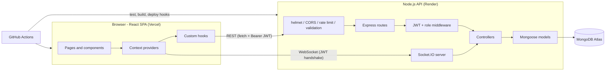

**Request flow:** React calls the REST API with `Authorization: Bearer <jwt>`. The `protect` middleware verifies the token, loads the user and checks `tokenVersion` and `isActive`. `authorize("admin")` enforces roles. Every database query is scoped to `req.user._id`, so users can never read another user's data (IDOR protection). When data changes, the server pushes events to the user's Socket.IO room, so open tabs and devices update instantly.

## Folder structure

```
FinanceFlow/
├── client/                    React + Tailwind frontend
│   ├── src/
│   │   ├── components/        ui/ (Button, Modal, Field, Card…), layout/, ChatThread, TransactionModal
│   │   ├── context/           AuthContext, ThemeContext, ToastContext, SocketContext, NotificationContext
│   │   ├── hooks/             useFetch, useForm, useDebounce, useDisclosure, useSocketEvent
│   │   ├── lib/               api client, formatters, validators
│   │   ├── pages/             auth/, admin/, Dashboard, Transactions, Budgets, Categories, Support, Profile
│   │   └── test/              Vitest tests
│   ├── Dockerfile, nginx.conf, vercel.json
├── server/                    Express API
│   ├── src/
│   │   ├── config/            env + database connection
│   │   ├── models/            User, Category, Transaction, Budget, Notification, Message
│   │   ├── middleware/        auth (JWT + roles), validate, error handler
│   │   ├── controllers/       business logic per resource
│   │   ├── routes/            REST routes + validation rules
│   │   ├── socket/            Socket.IO auth, rooms, presence, chat
│   │   ├── services/          notifications
│   │   └── seed.js, devMemory.js
│   ├── tests/                 Jest + Supertest API tests
│   └── Dockerfile
├── docs/                      API.md, DATABASE.md, Postman collection, screenshots
├── docker-compose.yml
├── render.yaml
└── .github/workflows/ci-cd.yml
```

## Getting started (local)

**Requirements:** Node.js 20+ and Git. MongoDB is optional (see option A).

```bash
git clone https://github.com/jaiprakash-talreja/FinanceFlow.git
cd FinanceFlow
```

### Option A: no database setup (in-memory MongoDB)

```bash
cd server
npm install
npm run dev:memory      # starts MongoDB in memory, seeds demo data, runs the API on :5000
```

In a second terminal:

```bash
cd client
npm install
npm run dev             # http://localhost:5173
```

### Option B: real MongoDB / Atlas

```bash
cd server
cp .env.example .env    # then set MONGODB_URI and JWT_SECRET
npm install
npm run seed            # creates demo accounts and sample data (wipes the database!)
npm run dev
```

### Environment variables

**server/.env**

| Variable | Example | Purpose |
|---|---|---|
| `NODE_ENV` | `development` | `production` hides error details |
| `PORT` | `5000` | API port |
| `MONGODB_URI` | `mongodb+srv://…/financeflow` | MongoDB connection string |
| `JWT_SECRET` | long random string | Signs JWTs |
| `JWT_EXPIRES_IN` | `7d` | Token lifetime |
| `CLIENT_URL` | `http://localhost:5173` | Allowed CORS origin(s), comma-separated |

**client/.env**

| Variable | Example | Purpose |
|---|---|---|
| `VITE_API_URL` | `http://localhost:5000` | Backend URL for REST and Socket.IO |

## Sample test users

| Role | Email | Password |
|---|---|---|
| Admin | `admin@financeflow.dev` | `Admin@1234` |
| User | `demo@financeflow.dev` | `Demo@1234` |
| User | `riya@financeflow.dev` | `Riya@1234` |

The login page has one-click buttons to fill the demo credentials.

## Testing

```bash
cd server && npm test     # 14 API tests: auth, CRUD, validation, IDOR, roles, chat (in-memory MongoDB)
cd client && npm test     # UI tests: validators, hooks, login form validation
```

**Postman:** import [`docs/FinanceFlow.postman_collection.json`](docs/FinanceFlow.postman_collection.json). It has 34 requests with assertions covering success and error cases (400, 401, 403, 404). To run it from the terminal:

```bash
npx newman run docs/FinanceFlow.postman_collection.json
```

## Docker

```bash
docker compose up --build
# web: http://localhost:8080   api: http://localhost:5000
docker compose exec api node src/seed.js   # optional demo data
```

`docker-compose.yml` runs three containers: `mongo` (with a volume and health check), `api` (Node 22 alpine, non-root user, health check) and `web` (multi-stage build served by nginx).

## CI/CD (GitHub Actions)

[`.github/workflows/ci-cd.yml`](.github/workflows/ci-cd.yml) runs on every push and pull request to `main`:

1. **API tests**: `npm ci` and Jest/Supertest
2. **Frontend**: Vitest tests and production build
3. **Docker**: builds both images
4. **Deploy** (push to `main` only, after everything passes): calls the Render and Vercel deploy hooks

Repository secret `RENDER_DEPLOY_HOOK` triggers the backend deploy on Render. The frontend deploys through Vercel's GitHub integration on every push to `main` (an optional `VERCEL_DEPLOY_HOOK` secret is also supported).

## Deployment

| Part | Platform | Settings |
|---|---|---|
| Database | MongoDB Atlas (free M0) | Allow access from `0.0.0.0/0`, copy the connection string |
| API | Render web service | Root `server`, build `npm ci --omit=dev`, start `node src/server.js`, env vars from the table above, auto-deploy off |
| Web | Vercel | Root `client`, framework Vite, env `VITE_API_URL=<Render URL>` |

After both are live, set `CLIENT_URL` on Render to the Vercel URL so CORS and WebSockets accept it.

## Documentation

- [API reference](docs/API.md): every endpoint, status codes and Socket.IO events
- [Database schema](docs/DATABASE.md): ER diagram, validation, indexes, relationships
- [Postman collection](docs/FinanceFlow.postman_collection.json)
- [Verified project checklist](docs/CHECKLIST.md)

## Screenshots

| | |
|---|---|
| 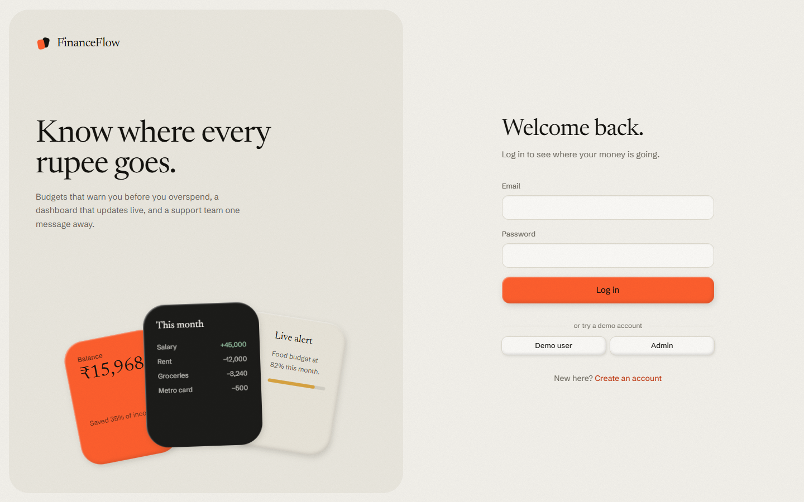 | 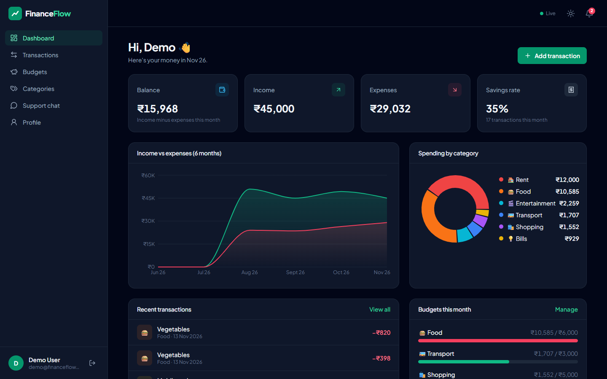 |
| 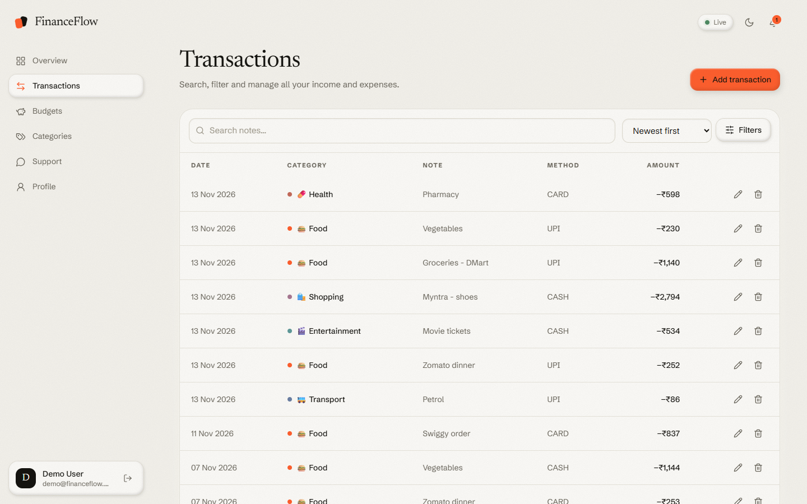 | 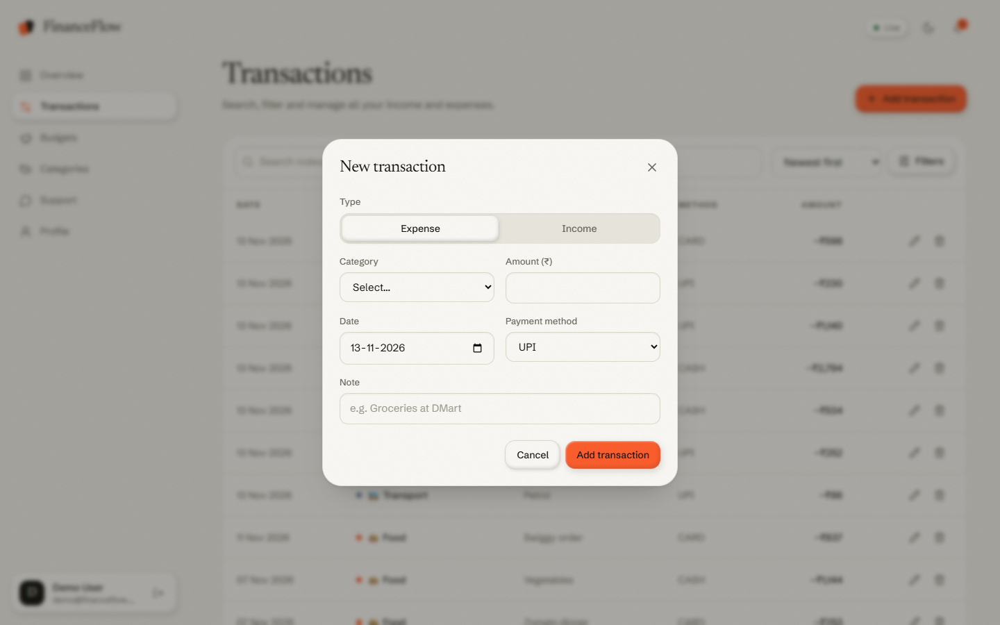 |
| 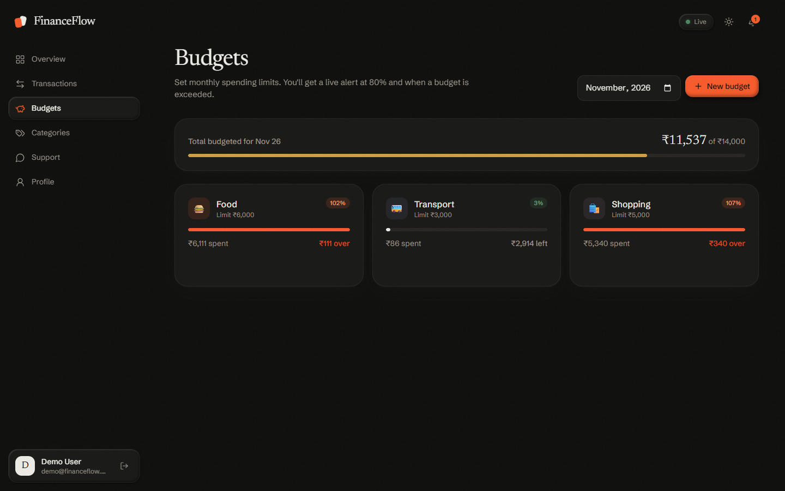 | 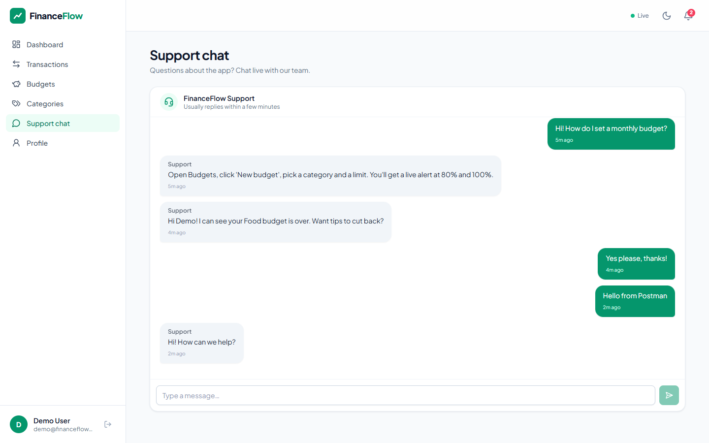 |
| 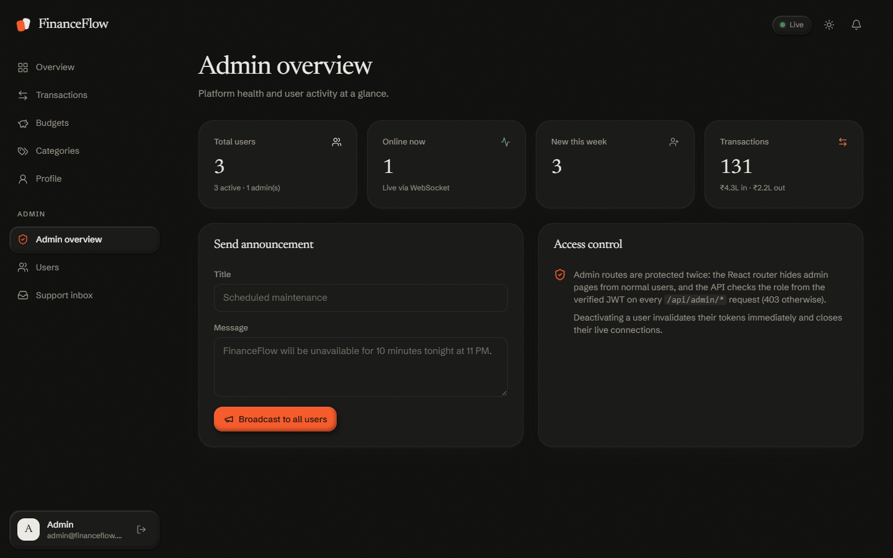 | 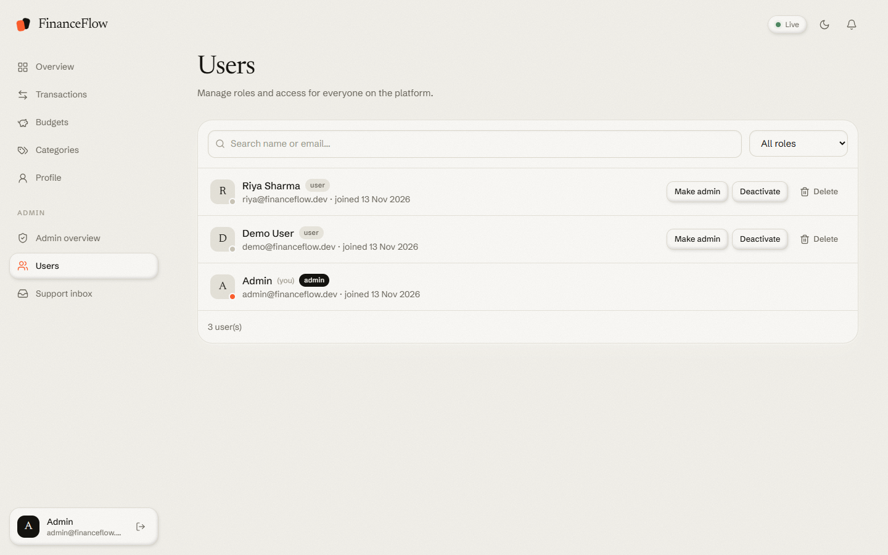 |
| 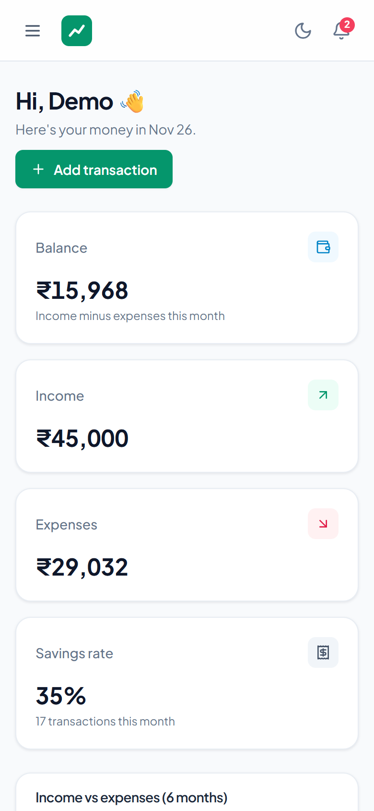 | 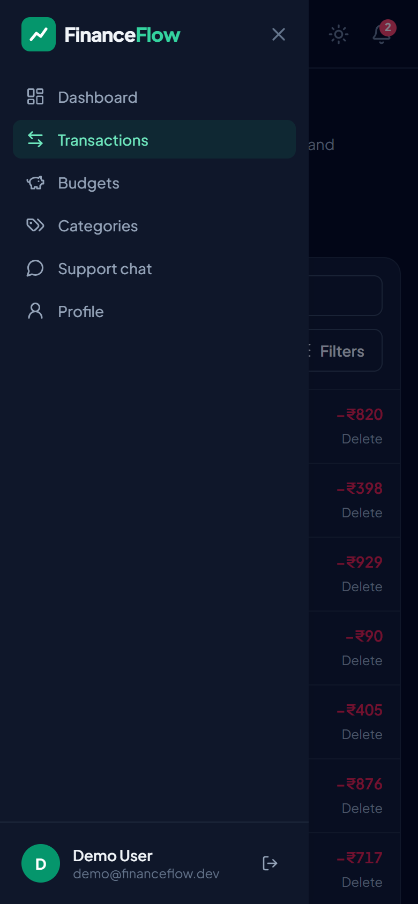 |

## Checklist coverage

| Requirement | Where |
|---|---|
| Responsive UI, responsive nav, dark mode | `components/layout/AppLayout.jsx` (sidebar on `lg`, drawer on mobile), `context/ThemeContext.jsx` |
| Tailwind, reusable components, consistent palette | `tailwind.config.js` (`brand` palette), `components/ui/*` |
| Forms with validation, loading, errors, success toasts | `hooks/useForm.js`, `lib/validators.js`, `components/ui/Spinner.jsx`, `context/ToastContext.jsx` |
| Modal / dialog | `components/ui/Modal.jsx`, `ConfirmDialog.jsx`, `TransactionModal.jsx` |
| Search / filter | `pages/Transactions.jsx`, `pages/admin/AdminUsers.jsx` (debounced search) |
| useState / useEffect with cleanup | `hooks/useFetch.js` (AbortController), `context/SocketContext.jsx` (disconnect), `hooks/useDebounce.js` |
| useContext + providers (multiple contexts) | `context/*` (5 providers in `main.jsx`) |
| Custom hooks reused | `useFetch`, `useForm`, `useDisclosure`, `useDebounce`, `useSocketEvent` used across pages |
| RESTful CRUD, status codes, API docs | `server/src/routes/*`, `docs/API.md` |
| Mongoose schemas, validation, references/populate, indexes | `server/src/models/*`, `docs/DATABASE.md` |
| Input validation, error middleware, .env, bcrypt, logging | `middleware/validate.js`, `middleware/error.js`, `config/env.js`, `models/User.js`, `utils/logger.js` + morgan |
| JWT register/login/logout, protected routes, token middleware | `controllers/authController.js`, `middleware/auth.js`, `components/layout/RouteGuards.jsx` |
| Admin/user roles, RBAC, unauthorized handling | `authorize("admin")`, `routes/adminRoutes.js`, `/forbidden` page, 401/403 responses |
| WebSockets: real-time updates, notifications, chat, connect/disconnect | `server/src/socket/index.js`, `context/SocketContext.jsx`, `components/ChatThread.jsx` |
| Dockerfile, .dockerignore, Compose, env vars | `server/Dockerfile`, `client/Dockerfile`, `docker-compose.yml` |
| GitHub Actions CI/CD, deployment | `.github/workflows/ci-cd.yml`, `render.yaml`, `client/vercel.json` |
| Testing | `server/tests/api.test.js`, `client/src/test/app.test.jsx`, Postman collection |
