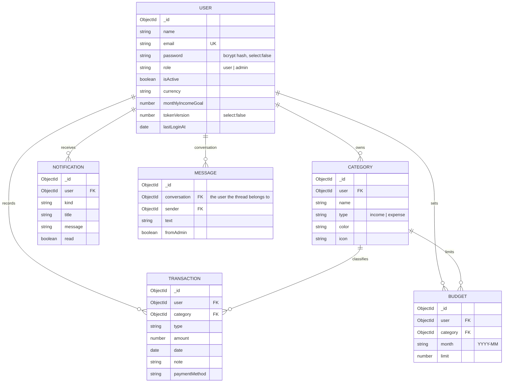

# Database Schema (MongoDB + Mongoose)

## Collections

| Model | Key validation | Indexes |
|---|---|---|
| **User** | name 2–60 chars, valid unique email, password ≥ 8 (hashed with bcrypt, cost 12), role enum | `email` unique, `role` |
| **Category** | name ≤ 40, type enum, hex color | `{ user, type, name }` unique |
| **Transaction** | amount > 0, date required, note ≤ 200, paymentMethod enum | `{ user, date: -1 }`, `{ user, category, date: -1 }`, text index on `note` |
| **Budget** | month `YYYY-MM`, limit ≥ 1 | `{ user, month, category }` unique |
| **Notification** | kind enum, title ≤ 100, message ≤ 500 | `{ user, read, createdAt: -1 }` |
| **Message** | text 1–1000 chars | `{ conversation, createdAt }` |

## Relationships

All relationships are **references** (`ObjectId` + `ref`) resolved with `.populate()`:

- `Transaction.category → Category` (populated with name, color, icon, type)
- `Budget.category → Category`
- `Message.sender → User` (name, role)
- Aggregations use `$lookup` for spending-by-category and the admin conversation list.

## Query optimisation

- Every query is filtered by `user` first, so the compound indexes above serve them.
- List endpoints use `.lean()`, pagination (`skip`/`limit`, max 100) and only populate the fields the UI needs.
- Dashboard totals, category breakdown and the 6-month trend run as three parallel aggregation pipelines.
- Sensitive fields (`password`, `tokenVersion`) are `select: false` and stripped in `toJSON`.
